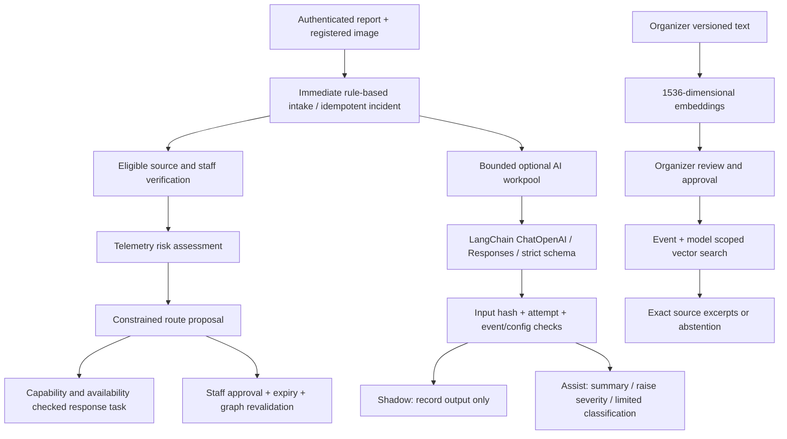

# EventPulse AI and agent operations

This implementation covers the plan's sections 6–8: optional OpenAI/LangChain enrichment, approved-source RAG, and the five-stage incident workflow. It is implemented and locally tested; production activation still requires the staging checks below. Local backend deployment and live provider connectivity have now been checked. No production deployment was performed.

## Architecture and authority

AI never verifies incidents, automatically merges semantic duplicates, approves routes, assigns arbitrary tools, or contacts emergency services. The agent stages are deterministic Convex functions with explicit dependencies, not autonomous model loops. LangChain is used for model and embedding adapters; LangGraph and durable chat history are not required for the implemented stateless question flow.

Rule-based incident creation runs independently of provider availability. Provider failures leave reports and staff triage available. AI output is schema validated, tied to a report hash and attempt, and rejected when its event, incident, report, model or configuration becomes invalid. Optional AI errors do not roll back report intake.

## Configuration

Use Node 22 or 24 for the local Convex backend and CI. The local backend now runs under Node 22.23.4, and full Convex function preparation/codegen succeeded. The system default remains Node 26; restart the backend using a supported Node runtime.

Set these **on the target Convex deployment**, never in `VITE_*` variables or browser code:

| Variable | Purpose |
| --- | --- |
| `EVENTPULSE_AI_ENABLED` | Exact value `true` enables configured AI; any other value is the deployment kill switch. |
| `OPENAI_API_KEY` | Server-side credential for the selected provider project. |
| `OPENAI_BASE_URL` | Optional HTTPS API root for a compatible provider; absent uses OpenAI. |
| `OPENAI_API_MODE` | `responses` (default) or `chat`. Chat mode explicitly uses LangChain ChatOpenAICompletions to prevent model-name heuristics selecting Responses. |
| `OPENAI_TEXT_MODEL` | Tested Responses model supporting strict JSON schema output. |
| `OPENAI_VISION_MODEL` | Optional tested model supporting image input and the same structured output contract. |
| `OPENAI_EMBEDDING_MODEL` | Optional embedding model supporting an explicit 1536-dimensional output. |

Pin and evaluate actual model IDs before rollout. No model or price is assumed in code. Changing embedding models requires creating/reindexing document versions and approving them; old-model chunks are excluded. Existing report embeddings are not automatically rebuilt, so duplicate recall can decrease after a model change.

In Command Center → AI, organizers choose:

- **Off** (default): no report enrichment.
- **Shadow**: record output for review without enriching the incident.
- **Assist**: add a summary, raise severity if suggested, and classify a single unverified `other` incident. Never lower severity or overwrite an established hazard type.

Vision and RAG have separate event switches. RAG can operate while report enrichment is off, if the deployment and RAG configuration are enabled. Simulated reports skip provider enrichment.

The deployment kill switch blocks new configured provider work and discards stale results. It does not recall requests already sent to OpenAI, erase stored output, or reverse an earlier severity increase. To disable all features for one event, set enrichment off and turn RAG and vision off.

## Evidence and privacy

New report images must be registered to an event and uploader, be JPEG/PNG/WebP, and be at most 5 MB. Registration expires for uploads older than ten minutes. The action reads stored bytes and checks signatures before constructing an image input; attendee-provided URLs are never fetched for AI. Access to newly registered evidence URLs requires membership of its event. Legacy generic file URLs retain their existing authenticated capability behavior for floor-map compatibility; legacy storage should be audited separately.

Vision produces qualitative observations and uncertainty only. Attachments do not prove authenticity, time, place, identity, occupancy, or verification. Old synthetic image analysis and confidence values are masked in the staff incident list unless a completed image analysis provides provenance.

Report text, optional image bytes, pasted SOP chunks, and staff questions can leave Convex for OpenAI when their features are enabled. Responses use `store: false`; this is not a guarantee of zero data retention. Confirm the provider project's retention, region and data-processing settings before using real attendee evidence. Do not put credentials or unnecessary personal data in SOPs. No external tracing service is configured.

## RAG workflow

1. Organizer pastes a source title, source identifier, version and text. Documents are immutable; replacements use a new version.
2. Index creates overlapping text chunks and embeddings. Documents are limited to 40,000 characters, 32 chunks, and 100 versions per event.
3. Organizer previews the complete source and approves it. Only one approved version per source identifier is active.
4. Staff asks a question. Authorization and quotas precede provider calls; vector search scopes results by event and embedding model.
5. The model selects at most five exact excerpts. The server verifies each quote occurs verbatim in its selected chunk, and rechecks approval, scope and access after generation. Unsupported answers abstain; errors return unavailable.
6. Revocation removes chunks from the active retrieval scope transactionally. A delayed indexing worker cannot overwrite a later generation.

Source excerpts are documentary evidence, not an authorization or a claim about live venue conditions. Similarity thresholds are initial heuristics requiring venue-specific evaluation. PDF parsing, OCR, remote URL crawling, hybrid search and free-form generated operational guidance are not included.

Semantic duplicate suggestions require a high similarity score plus matching hazard type, nearby pins and a limited time window. They require staff review and never auto-merge. Existing deterministic intake deduplication remains conservative and type-aware.

## Agent workflow and failure handling

| Stage | Implemented behavior | Held for human review |
| --- | --- | --- |
| Intake | Immediate rule fallback, Unicode/Hindi support, idempotent links, conservative duplicate detection, neutral custom-map locations | Ambiguous language/hazard and contradictory evidence |
| Verification | Eligible, non-rejected reports from non-banned members; type-specific trust/source rules; explicit staff attestation | Physical confirmation; attachment presence never bypasses policy |
| Crowd intelligence | Rule-based risk from recorded occupancy/flow/blockage; manual staff telemetry updates | Sensor accuracy, physical capacity and risk calibration |
| Routing | Directed graph, hard exclusions, projected group capacity at every corridor and destination, explicit egress designation | Every route requires staff approval; unplaced people remain on hold |
| Dispatch | Atomic responder reservation, capability and membership checks, 100 m initial search with expansion, rejection/timeout reassignment | Real emergency-service contact is held; no notification success is fabricated |

Assessment reservations are completed/released after verification so qualified responders can receive response tasks. Task lifecycle is pending → accepted → en_route → on_scene → completed, with allowed rejection/escalation/cancellation paths. Resolution cancels active tasks and routes. Evidence rejection re-evaluates verification and can invalidate routes and response tasks.

Routing plans one-minute guidance waves at no more than 85% of each zone's occupancy capacity and each directed corridor's per-minute throughput. Active proposals reserve capacity before approval, so simultaneous incidents cannot allocate the same headroom. The planner tries the next reachable designated egress/exit when a destination fills and logs any remainder for supervised phased movement. Organizers designate egress gates in the zone editor; a gate is never assumed to be an exit. A route is rechecked against current telemetry and other reservations at approval. Telemetry changes invalidate active recommendations; movement requires fresh telemetry and control-room approval. Capacity and throughput values are venue configuration, not certified measurements.
After approval, only verified active incident routes appear in attendee guidance and on the map. Pending proposals stay staff-only. Public text names the affected zone and limits movement to the staff-directed group for that wave.

Responder selection requires a matching capability for response, starts within 100 m, and expands beyond it when no suitable responder is near. It considers recent task count before distance among equally skilled candidates. Unverified urgent incidents can receive a staff verification task; response dispatch requires VERIFIED status. Pending tasks escalate after three minutes, rejection triggers reassignment immediately, and accepted tasks without an on-scene update produce a control-room warning after their review deadline.

Manual telemetry and route proposals expire after 120 seconds. Missing telemetry is unknown. The graph limit is 100 zones and 400 directed edges. Confirm both directions where a corridor is bidirectional. ETA and distance use uncalibrated map-percentage estimates; they are not surveyed travel times. Route risk, trust thresholds, crowd heuristics and staff attestation must be validated for the venue.

The paced demo is labeled separately from live execution. Audio transcription explicitly reports unsupported functionality rather than returning an invented transcript. There is no continuous video/CV or functioning external emergency notification integration.
Starting a new surge demo resets only simulation-sourced zone readings and invalidates old proposals. Manually observed zones keep their recorded state; stale manual observations can still prevent routing until staff refresh them.

## Bounds, diagnostics and recovery

- Workpool parallelism: 4 enrichment/indexing jobs. SDK and workpool automatic retries are disabled.
- Provider timeout: 20 seconds; structured generation also has a 25-second abort signal. Enrichment and indexing have 120-second watchdogs.
- Report enrichment: at most three started attempts, with explicit staff retries after fallback. Late completions/failures/watchdogs cannot affect a newer attempt.
- Event report-start quota: 30/minute, burst capacity 10. Shared daily event quota: 1,000 units, charged for model/embedding requests or indexed chunks.
- Staff question quota: 6/minute per user, burst 3. Document operation quota: 4/minute per user, burst 2.
- Quotas count configured units, not dollars or precise tokens. Set provider project spending controls and review actual usage; RAG calls execute outside the enrichment workpool and remain bounded by quotas, not a global four-request semaphore.
- AI records include mode, status, prompt/input versions, attempts, model, token usage where provided, sanitized error codes and timestamps. Agent logs record operational decisions. Do not persist raw SDK errors or credentials.

Monitor fallback/timeout/refusal rates, queue age, quota denials, source abstentions, stale telemetry, failed live runs and unacknowledged tasks. The command center exposes recent status and retries; no external alerts, automatic data retention/deletion jobs or cost dashboard are included. Agree on retention and implement deletion/export operations before a sensitive deployment.

## Release procedure

1. Back up the deployment and retain the current frontend/backend release. Use an isolated staging deployment with test users and synthetic evidence. Keep the AI kill switch off during initial schema rollout.
2. Install supported Node 22/24, run `npm ci`, then `npx convex codegen` against staging. This must regenerate and validate component definitions, Node bundles and environment bindings. `scripts/codegen-local.mjs` only refreshes API types offline from existing component declarations; it is not a deployment or full codegen substitute.
3. Run `npm run build`, `npm run typecheck:backend`, `npm run lint`, `npm test`, and `npm audit`. CI runs these without provider secrets. Review generated types and additive schema/index backfill on the staging dataset before deploying.
4. Smoke-test login, event creation and joining, QR/manual join, floor-map upload, report submit/retry, image upload, moderation, trust updates, map/feed subscriptions and event role separation in a browser. Automated backend tests cover key contracts but do not replace this browser pass.
5. Enable text enrichment in shadow for a test event. With real staging credentials, validate multilingual/negated/conflicting reports, refusals, invalid output, 429s, timeouts, kill switch, quota exhaustion, repeated retries and stale completions. Review real token/cost data and model compatibility.
6. Enable vision only after text passes; test a real valid image, malformed file, unsupported format, ownership boundary and uncertain visual content. Record false claims and false negatives with staff reviewers.
7. Index a reviewed SOP version. Test supported questions, unsupported questions, injected instructions in sources/questions, cross-event access, model change, revocation during generation, and exact citation matching.
8. Walk through source verification, assessment-to-response handoff, responder accept/travel/on-scene/complete, timeout escalation, report rejection and incident resolution. Test missing/stale telemetry, blocked exits, no route, changed graph and expired route approvals. Route approval must never be inferred from AI output.
9. Review shadow output against a venue-specific labeled evaluation set, including critical-hazard misses, false escalation, language fidelity, image hallucinations, citation support and access isolation. Select acceptance thresholds with event operators. Enable assist for a limited pilot only after acceptance.
10. Roll out backend before the matching frontend and expand gradually. On problems, disable AI immediately, keep manual triage available, inspect records, and forward-fix or restore a compatible release. Old backend/frontend releases may not understand new task states, so code rollback requires schema/state compatibility review; do not delete new tables or attempt a blind downgrade.

## Verification status

Local automated checks validate backend behavior with convex-test and provider adapter requests with mocked HTTP. They do not validate real OpenAI credentials, deployed components, browser behavior, load, vendor availability, or venue safety. Complete the staging procedure before treating this as production-ready.

## Current local provider setup

The local deployment uses `https://openrouter.ai/api/v1` in Chat Completions mode with `google/gemini-2.5-flash`, selected by the user on 30 October 2026. The OpenRouter credential is stored server-side in the local Convex environment and the ignored, owner-readable `.env.ai.local` file. No production environment was modified.

Live requests through the actual LangChain provider adapter succeeded with synthetic inputs:

- Incident analysis returned schema-valid medical classification, severity, summary, observations and uncertainty (approximately 3.4 seconds in this single check).
- Citation selection returned a literal quote and matching chunk identifier from a fictional source (approximately 1.4 seconds in this single check).

These are single-request contract checks, not latency benchmarks, broad quality evaluations or complete end-to-end RAG tests. The earlier Luna configuration failed because of the OpenRouter account's provider restrictions; Gemini now works with the account's permitted Google providers.

Vision is configured locally to use `google/gemini-2.5-flash` through the same OpenRouter Chat Completions adapter as text. To exercise it, the local deployment must be running, then an organizer must select Shadow or Assist, enable “Analyze stored photos,” and submit a normal report with a registered JPEG/PNG/WebP upload. Simulated reports skip provider analysis, and their public showcase image URLs are display-only; the Agent 1 showcase is deterministic text triage and deduplication, not a live vision call. Embeddings remain unconfigured, so RAG indexing and semantic duplicate suggestions are unavailable. Successful citation selection does not mean vector indexing/retrieval has been validated.

The provider switch changed environment configuration only. The latest automated suite has 28 passing tests; frontend build, backend typecheck and lint previously passed. The local frontend is http://localhost:5173 and backend http://127.0.0.1:3210. The local Convex backend has successfully prepared functions under Node 22. Authenticated browser regression, broader model evaluations and production release checks remain necessary.
